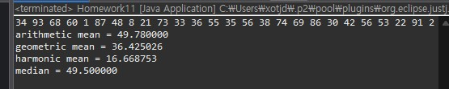
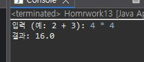
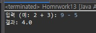
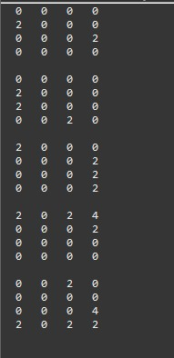

# OOP2026
### Homework1
```java

public class Homework1 {

	public static void main(String[] args) {
		int i, j;
        for (i = 0; i < 10; i++) {
            for (j = 0; j <= i; j++) {
                System.out.print("#");
            }
            System.out.println();
        }
        
        System.out.println();

        for (i = 0; i < 10; i++) {
            for (j = 0; j < 10 - i; j++) {
                System.out.print("#");
            }
            System.out.println();
        }

        for (i = 0; i < 10; i++) {
            for (j = 0; j < 9 - i; j++) {
                System.out.print(" ");
            }
            for (j = 0; j <= i; j++) {
                System.out.print("#");
            }
            System.out.println();
        }

        System.out.println();
        
        for (i = 0; i < 10; i++) {
            for (j = 0; j < i; j++) {
                System.out.print(" ");
            }
            for (j = 0; j < 10 - i; j++) {
                System.out.print("#");
            }
            System.out.println();
        }

	}

}


```


### Homework2
```java
public class Homework2 {

	public static void main(String[] args) {
		int a = 0;
		int b = 1;
		
		for(int i = 1; i<=20; i++) {
			System.out.print(a + " ");
			
			int next = a + b;
			a = b;
			b = next;
		}

	}

}
```


### Homework3
```java

public class Homework3 {

	public static void main(String[] args) {
		
		int a=1;
		int b=2;
		
		for(int i=1; i<=20; i++) {
			double ratio = (double) b / a;
			System.out.println(b + " / "+a+" = "+ratio);
			
			int next = a + b;
			a = b;
			b = next;
		}
	}

}

```


### Homework4
```java

public class Homework4 {

	public static void main(String[] args) {
		int i;
		int j;
		
		for(j = 1; j <= 9; j++) {
			for(i = 1; i <= 9; i++) {
				System.out.println(i+ "*" + j + "=" + (i*j)+ "\t");
			}
			System.out.println();
		}

	}

}

```


### Homework5
```java

public class gregory {
    
    public static double Gregory_Leibniz(int terms) {
        double pi = 0;

        for (int k = 0; k < terms; k++) {
            double sign;
            if (k % 2 == 0) {
                sign = 1.0; // 짝수
            } else {
                sign = -1.0; // 홀수
            }
            double term = sign * 4.0 / (2 * k + 1);
            pi += term;
        }

        return pi;
    }

    public static double Madhava(int terms) {
        double sum = 0;
        int sign = 1;

        for (int i = 0; i < terms; i++) {
            sum += sign * 1.0 / ((2.0 * i + 1.0) * Math.pow(3.0, i));
            sign *= -1;
        }
        return sum * Math.sqrt(12.0);
    }

    public static void main(String[] args) {
        int glTerms = 1000000;
        int madhavaTerms = 20;

        System.out.println("자바 기본 Math.PI 값: " + Math.PI);
        
        double glResult = Gregory_Leibniz(glTerms);
        System.out.println("그레고리 라이프니츠 결과 : " + glResult);
        
        double madhavaResult = Madhava(madhavaTerms);
        System.out.println("마다바 결과 : " + madhavaResult);
    }
}
```


### Homework6
```java
public class Binomial {
	public static void main(String[] args) {
	int n = 7;
    int binomial[][] = new int[n][];

    for (int i = 0; i < n; i++) {
        binomial[i] = new int[i + 1];
        
        for (int j = 0; j <= i; j++) {
            if (j == 0 || j == i) {
                binomial[i][j] = 1;
            } else {
                binomial[i][j] = binomial[i - 1][j - 1] + binomial[i - 1][j];
            }
        }
    }
    for (int i = 0; i < n; i++) {
        for (int j = 0; j <= i; j++) {
            System.out.print(binomial[i][j] + " ");
        }
        System.out.println();
    }
}
}
```


### Homework7
```java
public class Sorting {
    public static void main(String[] args) {
    	
        int data[] = new int[20];

        for(int i = 0; i < 20; i++) {
            data[i] = (int)(Math.random() * 100);
        }
        for(int i = 0; i < data.length - 1; i++) {
            int minIdx = i;
            
            for(int j = i + 1; j < data.length; j++) {
                if(data[j] < data[minIdx]) {
                    minIdx = j;
                }
            }
            
            int temp = data[i];
            data[i] = data[minIdx];
            data[minIdx] = temp;
        }

        for(int i = 0; i < 20; i++) {
            System.out.println(data[i]);
        }
    }
}
```


### Homework8
```java
public class Math_random {

	public static void main(String[] args) {

		        int score[][] = new int[30][6];

		        for (int i = 0; i < 30; i++) {
		            score[i][0] = i + 1;

		            int sum = 0;
		            for (int j = 1; j <= 4; j++) {
		                score[i][j] = (int)(Math.random() * 101);
		                sum += score[i][j];
		            }
		            score[i][5] = sum;
		        }
		        for (int i = 0; i < 30; i++) {
		            for (int j = 0; j < 6; j++) {
		                System.out.printf("%4d", score[i][j]);
		            }
		            System.out.println();
		        }
		    }
	}
```


### Homework10
```java
public class HomeWork10 {
    public static void main(String[] args) {
        if (args.length != 4) {
            System.out.println("인자 4개를 입력해주세요: array_count max_value bin_size display_scale");
            return;
        }

        int array_count = Integer.parseInt(args[0]);
        int max_value = Integer.parseInt(args[1]);
        int bin_size = Integer.parseInt(args[2]);
        int display_scale = Integer.parseInt(args[3]);
        int hist_size = max_value / bin_size;

        int[] arr = new int[array_count];
        int[] hist = new int[hist_size];

        for (int i = 0; i < array_count; i++) {
            arr[i] = (int) (Math.random() * max_value);
        }

        for (int i = 0; i < array_count; i++) {
            int index = arr[i] / bin_size;
            if (index < hist_size) {
                hist[index]++;
            }
        }

        for (int i = 0; i < hist_size; i++) {
            int start = i * bin_size;
            int end = start + bin_size - 1;
            
            System.out.printf("%2d~%-2d : ", start, end);
            
            int starCount = hist[i] / display_scale;
            for (int j = 0; j < starCount; j++) {
                System.out.print("#");
            }
            System.out.println();
        }
    }
}
```


### Homework11
```java
import java.util.Arrays;

public class Homework11 {
    public static void main(String[] args) {
        if (args.length != 1) {
            System.out.println("데이터 개수(array_count) 인자 1개를 입력해주세요.");
            return;
        }

        int array_count = Integer.parseInt(args[0]);
        double[] arr = new double[array_count];
        for (int i = 0; i < array_count; i++) {
            arr[i] = (int) (Math.random() * 99) + 1;
        }

        // 배열 출력
        for (int i = 0; i < array_count; i++) {
            System.out.print((int)arr[i] + " ");
        }
        System.out.println();

        // 산술평균
        double sum = 0;
        for (int i = 0; i < array_count; i++) {
            sum += arr[i];
        }
        double arithmeticMean = sum / array_count;
        System.out.printf("arithmetic mean = %f\n", arithmeticMean);

        // 기하평균
        double prod = 1;
        for (int i = 0; i < array_count; i++) {
            prod *= arr[i];
        }
        double geometricMean = Math.pow(prod, 1.0 / array_count);
        System.out.printf("geometric mean = %f\n", geometricMean);

        // 조화평균
        double reciprocalSum = 0;
        for (int i = 0; i < array_count; i++) {
            reciprocalSum += 1.0 / arr[i];
        }
        double harmonicMean = array_count / reciprocalSum;
        System.out.printf("harmonic mean = %f\n", harmonicMean);

        // 중앙값
        double[] sortedArr = arr.clone();
        Arrays.sort(sortedArr);
        
        double median;
        if (array_count % 2 == 1) {
            // 홀수 인 경우 가운데 값
            median = sortedArr[array_count / 2];
        } else {
            // 짝수 인 경우 가운데 두 값 평균
            median = (sortedArr[(array_count / 2) - 1] + sortedArr[array_count / 2]) / 2.0;
        }
        System.out.printf("median = %f\n", median);
    }
}
```



### Homework13
```java
import java.util.Scanner;

public class Homrwork13 {
    public static void main(String[] args) {
        Scanner scanner = new Scanner(System.in);
        
        System.out.print("입력 (예: 2 + 3): ");
        String inputString = scanner.nextLine();
        
        String[] arr = inputString.split(" ");
        
        if (arr.length == 3) {
            double num1 = Double.parseDouble(arr[0]);
            String op = arr[1];
            double num2 = Double.parseDouble(arr[2]);
            double result = 0;
            
            // 연산자
            if (op.equals("+")) {
                result = num1 + num2;
            } else if (op.equals("-")) {
                result = num1 - num2;
            } else if (op.equals("*")) {
                result = num1 * num2;
            } else if (op.equals("/")) {
                result = num1 / num2;
            } else if (op.equals("#")) {
                result = num1 + num2;
            }
            
            System.out.println("결과: " + result);
        } else {
            System.out.println("형식이 올바르지 않습니다.");
        }
        
        scanner.close();
    }
}
```



### Homework14
```java
import java.util.Arrays;

class Numbers {
    int num[];

    // 생성자
    Numbers(int num[]) {
        this.num = num;
    }
    // 총합 구하기
    double getTotal() {
        double sum = 0;
        for (int i = 0; i < num.length; i++) sum += num[i];
        return sum;
    }
    // 산술평균
    double getArithmeticMean() {
        return getTotal() / num.length;
    }
    // 조화평균
    double getHarmonicMean() {
        double reciprocalSum = 0;
        for (int i = 0; i < num.length; i++) {
            if (num[i] == 0) continue; // 0 방지
            reciprocalSum += 1.0 / num[i];
        }
        return num.length / reciprocalSum;
    }
    // 기하평균
    double getGeometricMean() {
        double prod = 1;
        for (int i = 0; i < num.length; i++) {
            prod *= num[i];
        }
        return Math.pow(prod, 1.0 / num.length);
    }
    // 중앙값
    int getMedian() {
        int[] sorted = num.clone();
        Arrays.sort(sorted);
        return sorted[sorted.length / 2];
    }
    // 정렬 메서드
    void sorting() {
        Arrays.sort(num);
    }
    void drawHistogram(int start, int end, int binCount, int scale) {
        int binSize = (end - start) / binCount;
        int[] hist = new int[binCount];

        for (int i = 0; i < num.length; i++) {
            int index = (num[i] - start) / binSize;
            if (index >= binCount) index = binCount - 1;
            if (index >= 0) hist[index]++;
        }
        for (int i = 0; i < binCount; i++) {
            int bStart = start + (i * binSize);
            int bEnd = bStart + binSize - 1;
            System.out.printf("%2d~%-2d : ", bStart, bEnd);
            
            int starCount = hist[i] / scale;
            for (int j = 0; j < starCount; j++) {
                System.out.print("#");
            }
            System.out.println();
        }
    }
    // 배열 출력 메서드
    void display() {
        System.out.printf("%3d :", num.length);
        for (int i = 0; i < num.length; i++) {
            System.out.printf("%3d ", num[i]);
        }
        System.out.println();
    }
}
public class Homework14 {
    public static void main(String[] args) {
        int size = 100;
        int data[] = new int[size];
        
        for (int i = 0; i < size; i++) {
            data[i] = (int) (Math.random() * 100);
        }
        
        Numbers obj = new Numbers(data);
        obj.display();
        
        System.out.printf("Arithmetic Mean : %5.2f\n", obj.getArithmeticMean());
        System.out.printf("Geometric Mean  : %5.2f\n", obj.getGeometricMean());
        System.out.printf("Harmonic Mean   : %5.2f\n", obj.getHarmonicMean());
        System.out.printf("Median          : %d\n", obj.getMedian());
        
        System.out.println("\n[Histogram]");
        obj.drawHistogram(0, 100, 10, 1);
    }
}
```



### Homework15
```java
class Class2048 {
    int value[][] = new int[4][4];

    Class2048() {
        init();    
    }

    void init() {
        addNewTile();
        addNewTile();
    }

    // 빈 공간에 무작위로 2 또는 4를 생성
    void addNewTile() {
        for (int k = 0; k < 100; k++) {
            int i = (int) (Math.random() * 4);
            int j = (int) (Math.random() * 4);
            if (value[i][j] == 0) {
                value[i][j] = ((int) (Math.random() * 2) + 1) * 2; // 2 또는 4
                break;
            }
        }
    }

    void update() {
        addNewTile(); // 이동 후 새 타일 추가
    }
    int[] mergeRow(int[] row) {
        int[] newRow = new int[4];
        int idx = 0;
        
        // 0이 아닌 숫자들을 앞으로 모으기
        for (int i = 0; i < 4; i++) {
            if (row[i] != 0) {
                newRow[idx++] = row[i];
            }
        }
        
        // 같은 숫자가 붙어있으면 합치기
        for (int i = 0; i < 3; i++) {
            if (newRow[i] != 0 && newRow[i] == newRow[i + 1]) {
                newRow[i] *= 2;
                newRow[i + 1] = 0;
            }
        }
        
        // 합친 후 다시 앞으로 모으기
        int[] result = new int[4];
        idx = 0;
        for (int i = 0; i < 4; i++) {
            if (newRow[i] != 0) {
                result[idx++] = newRow[i];
            }
        }
        return result;
    }
    void left() {
        for (int i = 0; i < 4; i++) {
            value[i] = mergeRow(value[i]);
        }
        update();
        display();
    }
    void right() {
        for (int i = 0; i < 4; i++) {
            int[] rev = {value[i][3], value[i][2], value[i][1], value[i][0]};
            rev = mergeRow(rev);
            value[i][3] = rev[0]; value[i][2] = rev[1]; value[i][1] = rev[2]; value[i][0] = rev[3];
        }
        update();
        display();
    }

    void up() {
        for (int j = 0; j < 4; j++) {
            int[] col = {value[0][j], value[1][j], value[2][j], value[3][j]};
            col = mergeRow(col);
            for (int i = 0; i < 4; i++) {
                value[i][j] = col[i];
            }
        }
        update();
        display();
    }   

    void down() {
        for (int j = 0; j < 4; j++) {
            int[] col = {value[3][j], value[2][j], value[1][j], value[0][j]};
            col = mergeRow(col);
            value[3][j] = col[0]; value[2][j] = col[1]; value[1][j] = col[2]; value[0][j] = col[3];
        }
        update();
        display();
    }

    void display() {
        for(int i=0; i<4; i++) { 
            for(int j=0; j<4; j++) 
                System.out.printf("%3d ", value[i][j]);
            System.out.println();
        }
        System.out.println();
    }    
}

public class Homework15 {
    public static void main(String[] args) {
    	Class2048 obj = new Class2048();
        obj.display();
        obj.left();
        obj.right();
        obj.up();       
        obj.down();
    }
}
```

