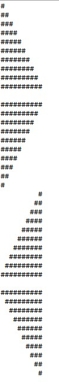
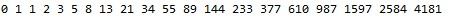
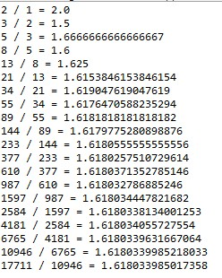
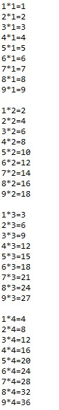
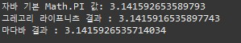
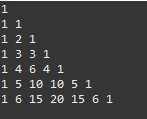
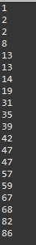
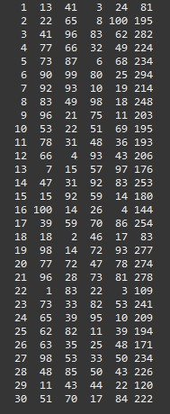
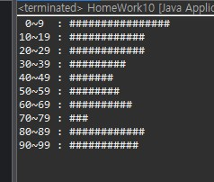

# OOP2026
### Homework1
```java

public class Homework1 {

	public static void main(String[] args) {
		int i, j;
        for (i = 0; i < 10; i++) {
            for (j = 0; j <= i; j++) {
                System.out.print("#");
            }
            System.out.println();
        }
        
        System.out.println();

        for (i = 0; i < 10; i++) {
            for (j = 0; j < 10 - i; j++) {
                System.out.print("#");
            }
            System.out.println();
        }

        for (i = 0; i < 10; i++) {
            for (j = 0; j < 9 - i; j++) {
                System.out.print(" ");
            }
            for (j = 0; j <= i; j++) {
                System.out.print("#");
            }
            System.out.println();
        }

        System.out.println();
        
        for (i = 0; i < 10; i++) {
            for (j = 0; j < i; j++) {
                System.out.print(" ");
            }
            for (j = 0; j < 10 - i; j++) {
                System.out.print("#");
            }
            System.out.println();
        }

	}

}


```


### Homework2
```java
public class Homework2 {

	public static void main(String[] args) {
		int a = 0;
		int b = 1;
		
		for(int i = 1; i<=20; i++) {
			System.out.print(a + " ");
			
			int next = a + b;
			a = b;
			b = next;
		}

	}

}
```


### Homework3
```java

public class Homework3 {

	public static void main(String[] args) {
		
		int a=1;
		int b=2;
		
		for(int i=1; i<=20; i++) {
			double ratio = (double) b / a;
			System.out.println(b + " / "+a+" = "+ratio);
			
			int next = a + b;
			a = b;
			b = next;
		}
	}

}

```


### Homework4
```java

public class Homework4 {

	public static void main(String[] args) {
		int i;
		int j;
		
		for(j = 1; j <= 9; j++) {
			for(i = 1; i <= 9; i++) {
				System.out.println(i+ "*" + j + "=" + (i*j)+ "\t");
			}
			System.out.println();
		}

	}

}

```



### Homework5
```java

public class gregory {
    
    public static double Gregory_Leibniz(int terms) {
        double pi = 0;

        for (int k = 0; k < terms; k++) {
            double sign;
            if (k % 2 == 0) {
                sign = 1.0; // 짝수
            } else {
                sign = -1.0; // 홀수
            }
            double term = sign * 4.0 / (2 * k + 1);
            pi += term;
        }

        return pi;
    }

    public static double Madhava(int terms) {
        double sum = 0;
        int sign = 1;

        for (int i = 0; i < terms; i++) {
            sum += sign * 1.0 / ((2.0 * i + 1.0) * Math.pow(3.0, i));
            sign *= -1;
        }
        return sum * Math.sqrt(12.0);
    }

    public static void main(String[] args) {
        int glTerms = 1000000;
        int madhavaTerms = 20;

        System.out.println("자바 기본 Math.PI 값: " + Math.PI);
        
        double glResult = Gregory_Leibniz(glTerms);
        System.out.println("그레고리 라이프니츠 결과 : " + glResult);
        
        double madhavaResult = Madhava(madhavaTerms);
        System.out.println("마다바 결과 : " + madhavaResult);
    }
}
```



### Homework6
```java
public class Binomial {
	public static void main(String[] args) {
	int n = 7;
    int binomial[][] = new int[n][];

    for (int i = 0; i < n; i++) {
        binomial[i] = new int[i + 1];
        
        for (int j = 0; j <= i; j++) {
            if (j == 0 || j == i) {
                binomial[i][j] = 1;
            } else {
                binomial[i][j] = binomial[i - 1][j - 1] + binomial[i - 1][j];
            }
        }
    }
    for (int i = 0; i < n; i++) {
        for (int j = 0; j <= i; j++) {
            System.out.print(binomial[i][j] + " ");
        }
        System.out.println();
    }
}
}
```



### Homework7
```java
public class Sorting {
    public static void main(String[] args) {
    	
        int data[] = new int[20];

        for(int i = 0; i < 20; i++) {
            data[i] = (int)(Math.random() * 100);
        }
        for(int i = 0; i < data.length - 1; i++) {
            int minIdx = i;
            
            for(int j = i + 1; j < data.length; j++) {
                if(data[j] < data[minIdx]) {
                    minIdx = j;
                }
            }
            
            int temp = data[i];
            data[i] = data[minIdx];
            data[minIdx] = temp;
        }

        for(int i = 0; i < 20; i++) {
            System.out.println(data[i]);
        }
    }
}
```


### Homework8
```java
public class Math_random {

	public static void main(String[] args) {

		        int score[][] = new int[30][6];

		        for (int i = 0; i < 30; i++) {
		            score[i][0] = i + 1;

		            int sum = 0;
		            for (int j = 1; j <= 4; j++) {
		                score[i][j] = (int)(Math.random() * 101);
		                sum += score[i][j];
		            }
		            score[i][5] = sum;
		        }
		        for (int i = 0; i < 30; i++) {
		            for (int j = 0; j < 6; j++) {
		                System.out.printf("%4d", score[i][j]);
		            }
		            System.out.println();
		        }
		    }
	}
```


### Homework10
```java
public class HomeWork10 {
    public static void main(String[] args) {
        if (args.length != 4) {
            System.out.println("인자 4개를 입력해주세요: array_count max_value bin_size display_scale");
            return;
        }

        int array_count = Integer.parseInt(args[0]);
        int max_value = Integer.parseInt(args[1]);
        int bin_size = Integer.parseInt(args[2]);
        int display_scale = Integer.parseInt(args[3]);
        int hist_size = max_value / bin_size;

        int[] arr = new int[array_count];
        int[] hist = new int[hist_size];

        for (int i = 0; i < array_count; i++) {
            arr[i] = (int) (Math.random() * max_value);
        }

        for (int i = 0; i < array_count; i++) {
            int index = arr[i] / bin_size;
            if (index < hist_size) {
                hist[index]++;
            }
        }

        for (int i = 0; i < hist_size; i++) {
            int start = i * bin_size;
            int end = start + bin_size - 1;
            
            System.out.printf("%2d~%-2d : ", start, end);
            
            int starCount = hist[i] / display_scale;
            for (int j = 0; j < starCount; j++) {
                System.out.print("#");
            }
            System.out.println();
        }
    }
}
```


